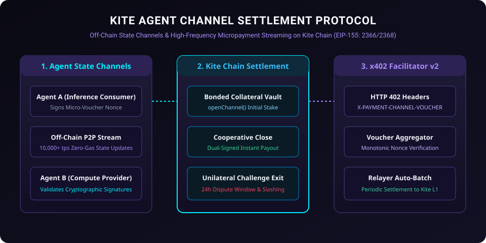

# Kite Agent Channel Settlement Protocol

<p align="center">
  
</p>

[](LICENSE)
[](https://gokite.ai)
[](#x402-channel-dynamics)
[](https://www.typescriptlang.org)

**Kite Agent Channel Settlement** is a high-throughput, off-chain state channel and bilateral micropayment streaming protocol designed specifically for autonomous AI agents operating on **Kite Blockchain** (EIP-155: Chain IDs `2366` / `2368`).

---

## 💡 Core Capabilities

1. **Sub-Millisecond AI-to-AI Payment Streaming**: Agents open bonded collateral channels on Kite Chain and stream thousands of micro-inferences per second off-chain via signed monotonically increasing state vouchers.
2. **Dual-Signature Channel Closure**: Bilateral cooperative close with instant on-chain balance settlement and zero dispute delay.
3. **Optimistic Dispute Challenge Window**: Unilateral exit protection backed by cryptographic timeout challenges (`challengeExpiry`) and fraud slashing.
4. **Native x402 Facilitator Integration**: Plug-and-play middleware conforming to Kite Chain's HTTP 402 Payment Required specification.

---

## 📐 Architecture Overview

```
      +-----------------------------+
      |   Agent A (Service Buyer)   |
      +--------------+--------------+
                     |
       (1) Deposit Collateral
                     v
   +------------------------------------+
   |  KiteAgentChannelSettlement.sol    | <--- On Kite Chain (EIP-155)
   +------------------------------------+
                     ^
       (4) Settlement / Slashing
                     |
      +--------------+--------------+
      |  Agent B (Provider Service) |
      +-----------------------------+
             ^               ^
             |               |
     (2) Streamed Vouchers (3) State Verification
             (Signed Off-Chain Packets)
```

---

## 🛠 Smart Contracts & TypeScript SDK

- **`contracts/KiteAgentChannelSettlement.sol`**: Solidity 0.8.24 smart contract providing:
  - `openChannel(address counterparty, uint256 challengePeriod)`
  - `cooperativeClose(bytes32 channelId, uint256 balanceA, uint256 balanceB, bytes sigA, bytes sigB)`
  - `initiateUnilateralClose(bytes32 channelId, uint256 nonce, uint256 balanceA, uint256 balanceB, bytes sig)`
  - `finalizeUnilateralClose(bytes32 channelId)`
- **`src/channel-manager.ts`**: EIP-712 structured voucher signing, verification, and non-decreasing nonce validator.
- **`src/channel-client.ts`**: Kite Chain Viem/Ethers provider client with automated gas-free fee relayer dispatch.

---

## 🚀 Quick Start

### Installation

```bash
git clone https://github.com/specificpict/kite-agent-channel-settlement.git
cd kite-agent-channel-settlement
npm install
```

### Run Test Suite

```bash
npm test
```

---

## 📜 License

Licensed under the [Apache License, Version 2.0](LICENSE).
